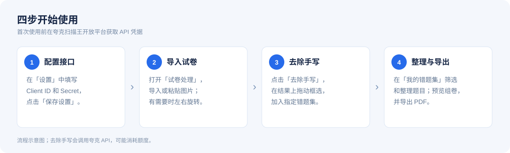
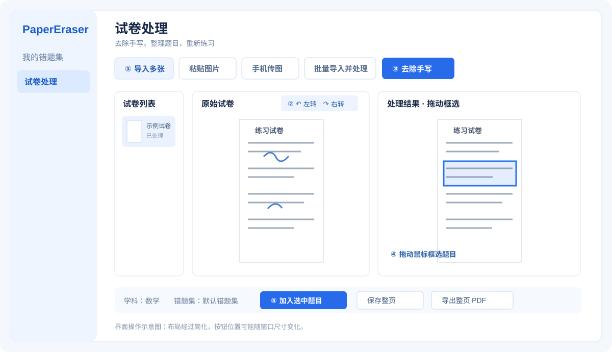

# PaperEraser

Windows 试卷去手写和错题整理工具。开发可用 Visual Studio 打开项目，或安装 .NET 10 SDK 后在项目目录运行 `dotnet run`。

## 下载和使用

从 [GitHub Releases](https://github.com/doublemarkpro/PaperEraser/releases/latest) 下载 `PaperEraser.exe`，在 64 位 Windows 上运行。发布版本包含运行所需的 .NET 运行时，无需另外安装；首次启动可能需要一些时间。打开设置填写夸克扫描王开放平台的 Client ID 和 Client Secret 后，即可导入试卷并去除手写。

## 图解使用

下图是依据软件界面整理的操作示意图，并非实际截图；具体布局会随窗口尺寸变化。

在「试卷处理」页面，先导入图片，必要时调整方向，再点击「去除手写」。处理完成后，在右侧结果中拖动框选题目，选择学科和错题集并加入；也可以直接保存整页或导出 PDF。

## 自动构建与发布

推送到 `main` 时，GitHub Actions 会在 Windows 上构建独立的 x64 可执行文件，并以 `v0.1.<运行编号>` 创建 Release、附上 `PaperEraser.exe`。也可以在 GitHub 的 Actions 页面手动运行构建。构建文件同时保存在对应运行记录的 Artifacts 中；构建期间若有更新的提交，旧版本不会创建 Release。

## 我的错题集

错题按「年级 → 学科 → 自定义错题集 → 题目」组织。例如先选择「三年级」「语文」，再建立「同步第一单元」「同步第二单元」或「期中复习」；四年级语文、三年级数学也可以建立自己的「同步第一单元」，不同年级和学科互不混淆。

1. 顶部先选择「年级」，再选择「学科大类」。已预置一年级到六年级、初一到初三、高一到高三，不需要手动创建；也可以通过「管理年级」自定义、重命名或删除空年级。
2. 点击「新建」，年级和学科默认沿用当前选择，只填写「同步第一单元」等名称即可，不必在名称里重复写年级、学科。
3. 已有错题集可以通过「编辑/归类」修改名称、年级或学科，集内所有题目一起归类。同一年级、同一学科内不能有同名错题集；不同年级或学科可以同名。
4. 框选加入题目或跨页拼题时，选择年级、学科及目标错题集；后续题目自动沿用该目标。移动题目时会显示「年级 / 学科 / 错题集」全名。

左侧以可展开的树显示「全部错题 → 年级 → 学科 → 单元错题集」，单元缩进在学科下方。点击年级或学科可查看其下全部题目，点击单元仅查看该集；箭头可展开、收起。选择顶部「全部年级」「全部学科」可浏览跨年级、跨学科的树。新建错题集默认沿用当前树节点的年级、学科。

年级或学科重命名会更新所属错题集；删除前需先移走其下的错题集。错题集可在同一年级、同一学科内拖动排序，蓝色插入线提示放置位置；跨组归类请使用「编辑/归类」。预览和导出使用当前筛选结果；清空操作仍会清空所有题目，包括筛选隐藏的题目。

首次升级会自动迁移旧数据：单一学科的旧错题集归入对应学科，混合多个学科的旧集按题目原有学科拆分（在不同学科下保留旧名称）；无题目的旧集仅在名称有明确学科前缀时自动归类，其余保留在「未分类」。没有年级信息的旧集会保留在「未设置年级」，用「编辑/归类」统一指定一次年级即可，不需逐题修改。题目、图片、顺序和复习资料会保留。涉及题目迁移或改学科的操作，会在本地数据目录的 `restore-backup-*` 子目录保留变更前副本；仅配置迁移时保存 `library.json.before-classification-*` 副本（早期版本为 `before-subject-groups`）。

错题保存在当前 Windows 用户本地应用数据目录 PaperEraser/basket.json。旧版本数据兼容读取，本次界面重构前的备份在同一目录，名称以 basket.before-redesign 开头。若检测到数据被其他窗口修改，将停止自动覆盖并提示；建议一次只打开一个程序版本。

## 试卷处理

选择、拖入或粘贴图片，也可手机传图或批量处理。导入时会按照片的 EXIF 方向自动转正；方向元数据缺失或错误时，可在原图标题栏使用“左转/右转”手动修正。仅点击去除手写会向夸克提交图片，可能消耗额度，失败不自动重试。重新处理已有结果会提示。处理完成后可保存整页、导出 PDF，或框选题目加入指定错题集。已处理图片也可重新打开继续选题。

批量处理前显示页数及确认，逐张提交，支持停止；遇到错误停止并保留已输出文件。失败后先确认后台用量，避免重复消耗。

## 多张已处理图片合并 PDF

若同一道题的上下半部分位于不同图片，请使用下面的「跨页选区拼题」，将片段合成一道错题；整页合并 PDF 使用本节功能。

在「试卷处理」工具栏点击「去除手写」前面的「多选排序导出 PDF」。窗口会列出当前所有已处理的页面（也包括通过「导入已处理图片」添加的图片），默认全部勾选。

1. 勾选需要导出的图片，也可以使用「全部勾选 / 全部取消」。
2. 拖动缩略图或名称调整顺序，蓝色插入线及文字提示会明确标出放置位置；拖到列表上下边缘可自动滚动。按住 Ctrl 或 Shift 可多选后一起拖动，也可以继续使用「上移 / 下移」。右侧可查看图片。
3. 点击「导出 PDF」选择保存位置。勾选的图片按列表从上到下排列，每张图片独占一页 A4，等比例居中、不裁切。

勾选决定是否导出，行选择用于排序，两者相互独立；调整顺序不会取消已勾选的页面。该操作无需再次调用夸克 API。

## 一道题跨两页：跨页选区拼题

1. 在第一张图片的「处理结果」中框选题目上半部分。
2. 切换到第二张图片，框选下半部分。第一张图片的选区会保留；可继续添加第三个片段，也支持同一页的多个选区。
3. 点击处理页面底部的「跨页选区拼题」。勾选属于同一道题的片段，用「上移 / 下移」按题目阅读顺序排列。
4. 查看右侧完整预览。可调整片段间距；如果两页拍摄比例不同，可选「统一片段宽度」。默认保留相对尺寸并左对齐，拼接不会裁切题目内容。
5. 输入题目名称，点击「拼成一道题并加入错题集」。学科和错题集沿用处理页面所选目标，拼好的图片作为一题保存，之后可照常编辑、复习和导出 PDF。

只有成功保存后才移除已使用的选区，未勾选的选区继续保留；取消窗口或保存失败不会清除原选区。整个拼接过程在本地完成，不会再次调用 API，也不会自动补写或识别缺失内容。

## 手机连续拍照传图

1. 手机和电脑连接同一可信 Wi-Fi，在电脑点击「手机传图」，选择保存文件夹并扫码一次。
2. 手机保持网页打开，点击「拍一张」连续拍照，或者使用「选择照片」批量添加。默认拍照或选图后自动排队逐张发送，上传完成会留在原页面，直接继续拍下一张。是否直接打开相机取决于手机系统和浏览器。
3. 电脑点击「隐藏窗口，继续接收」或窗口关闭按钮，都只会隐藏小窗口；可同时在主界面整理试卷。再次点击「手机传图」，仍是原来的接收会话和二维码。
4. 需要结束时点击「停止接收」，或退出整个软件。此时链接失效，重新开启接收需要扫新二维码。

手机页面显示上传队列、逐张进度和保存状态，也可关闭自动发送后手动发送。断网、手机息屏或浏览器切换可能中断传输，回到原页面后可点击「重试未完成照片」；同一接收会话内会核对原上传编号，避免因成功响应丢失而重复保存。刷新或关闭手机网页会丢失尚未完成的本页队列，请先确认照片已保存。清理已完成记录只会清理手机页面，不会删除电脑文件。

每张不超过 10 MB，支持 JPG、PNG、GIF、BMP、TIFF；连续传图页面自动逐张发送，普通无脚本上传每批最多 10 张。传图不调用夸克 API，收到的照片仍保存在选定文件夹，可用「导入多张」添加到试卷列表。二维码包含本次运行的临时访问密钥，本地传输使用 HTTP，请勿在不可信网络使用；网络地址发生变化时需重新选择可用地址。

## 设置

API Client ID 和 Client Secret 在设置中输入，勾选记住凭据后保存在当前 Windows 用户的凭据管理器中。清除按钮删除已保存凭据；取消勾选本身不会删除旧凭据。真实接口额度以夸克后台为准。

接口：https://scan.quark.cn/business/docs-v2?referenceId=33&tab=api

## 浏览和整理

错题集首页的搜索框可搜索题目名称、学科、知识点和备注；复习状态可以单独筛选。双击题目直接编辑；按住卡片拖到另一题的位置可调整顺序，顺序自动保存。上移、下移按钮仍可使用。预览和 PDF 导出都在错题集首页，使用当前筛选结果。

点击「预览组卷」或「配置并导出 PDF」后，默认勾选当前筛选出的题目。窗口左侧可切换不同年级、学科下的错题集，逐题勾选或批量勾选当前列表；切换错题集会保留此前选择，支持跨集组卷。下方「已选题目」可直接拖动名称或左侧拖动柄排序，蓝色插入线和文字提示放置位置，拖到列表上下边缘会自动滚动。点击每行右侧「×」直接移出本次试卷，同时取消上方对应勾选，错题库中的原题保留。

点击「随机乱序」可重新打乱已选题目的顺序；点击「恢复原序」恢复它们在错题库中的原有顺序。右侧预览立即更新，导出的 PDF 使用同一顺序。选题、乱序和移出操作只影响当前组卷，不会删除错题或改变错题库排序；关闭组卷窗口后，本次临时选题不保存。

顶部「排版」可选「一页单列」或「一页两列」。双列按左列从上到下、再右列从上到下排列，放满后自动换页；标题横跨两列，列间距为 8 毫米。切换双列会自动将题目等比例缩放到列宽内；「列内大小 %」可继续缩小，例如 80% 表示占当前列宽的 80%。题目保持完整，不跨列裁切；间距、答题留白和页边距仍可调整，预览与 PDF 使用同一排版。

## 构建与运行

直接运行 `dotnet build` 使用项目标准输出路径 `bin/Debug/net10.0-windows/PaperEraser.exe`，以后可复用同一位置。运行中的程序会占用文件，请在重新构建前关闭该版本。拖动错题卡片时，蓝色竖线表示将插入到目标卡片的左侧或右侧。手机传图选择文件夹后，可点击“打开传图文件夹”。

错题卡片左侧的数字是当前筛选结果中的显示序号，拖拽、删除或筛选后会自动重排；它不写入题目名称。旧版本自动添加在名称前的数字仅在卡片显示时隐藏，原始名称不会被改写。双击编辑名称时，只有主动修改名称才会保存新名称。

## 试卷进度与备份

试卷处理列表中的原图、去手写结果、框选区域和当前页会自动保存到本机数据目录的 session 子目录，重新打开程序可继续整理，无需再次调用接口。原始文件不会因移除列表中的页面而删除。缓存读取失败时会暂停自动保存并提示，避免覆盖原有进度。session 子目录中可能保留已移出列表的缓存文件。

设置中的“备份数据”可将错题图片、题目资料、学科和错题集配置导出为 ZIP；恢复会替换当前这些数据，并先在本机数据目录保留恢复前副本。试卷处理进度、调用记录和 API 凭据不包含在该备份中。

## 用量与组卷

首页提供夸克后台用量入口，实际调用及扣费以平台记录为准。网络错误等未确定结果请先到后台核对，避免重复提交。

错题集首页的预览和导出可设置试卷标题、题目大小、题间距、答题留白及页边距；预览和 PDF 使用相同排版。标题作为图片写入 PDF。

编辑错题时，点击题目缩略图或「放大预览」按钮，可打开独立预览窗口。支持放大、缩小、100%、适合宽度、查看全图及 Ctrl + 滚轮缩放；普通滚轮用于上下浏览长题。预览窗口可以移到一旁，对照题目填写知识点、错因和备注。按 Esc、点击「关闭预览」或窗口关闭按钮即可退出预览，已填写但尚未保存的编辑内容会保留。预览只改变显示比例，资料仍需在编辑窗口点击「保存修改」才会保存。

错题集列表中的彩色标识按所属学科区分；同年级、同学科内拖动列表项可调整顺序，蓝色横线表示插入位置，顺序自动保存。“全部错题”是当前年级、学科的汇总入口，选择「全部年级」「全部学科」后可查看所有题目。学科下拉框和题目卡片也会按学科显示颜色。
